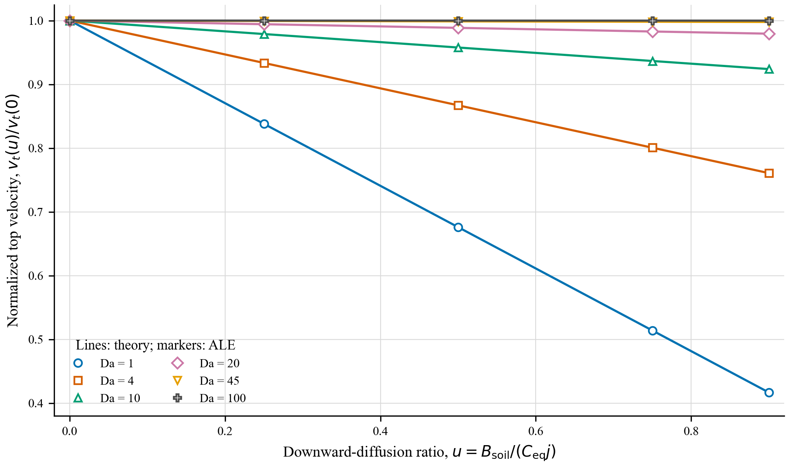
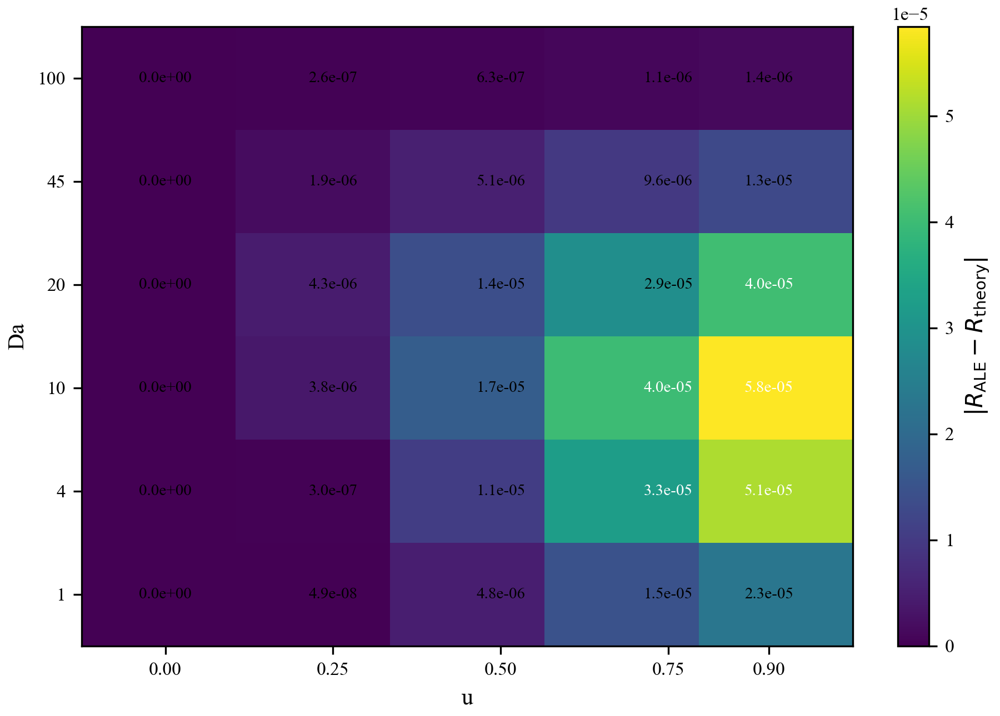
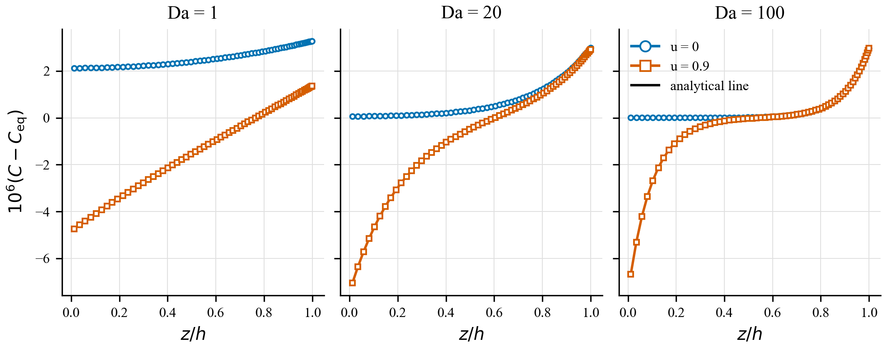
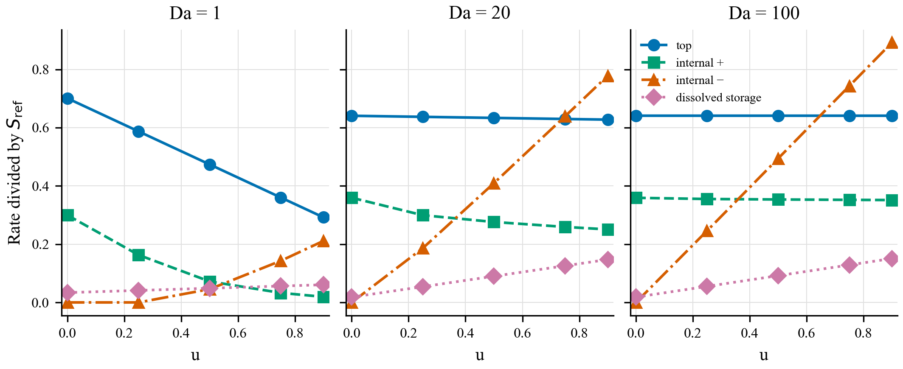
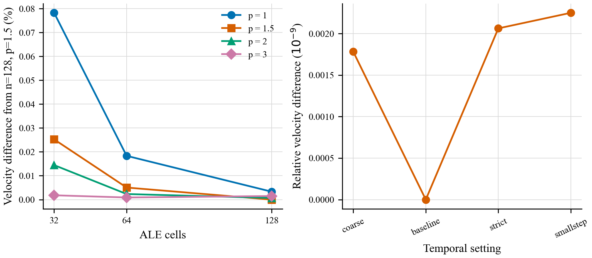
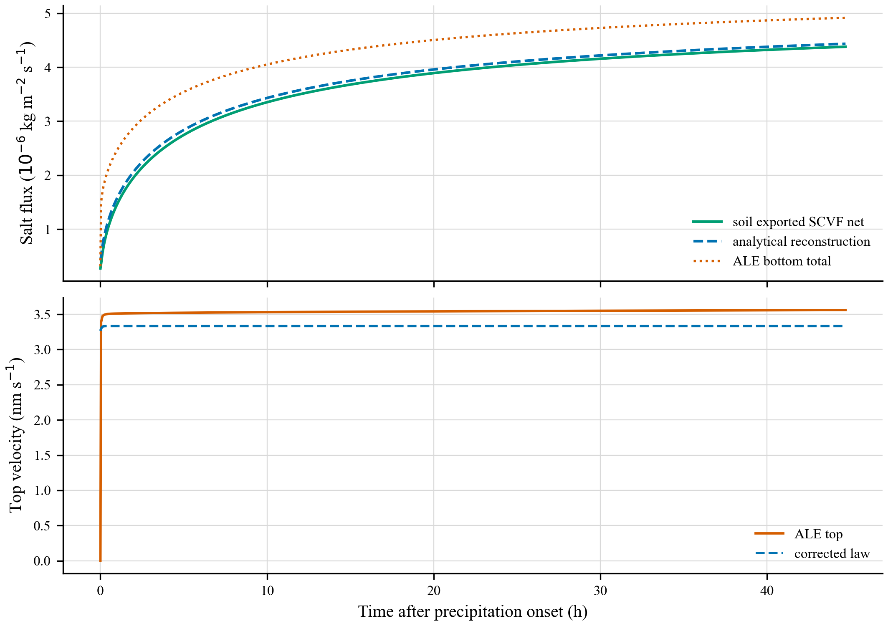

# 修正有限 Da 增长律的独立 ALE 验证

## 结论

受控 Neumann 边界问题通过了数学与数值两级验证。独立 BVP 与闭式解在
30 组参数上的顶速最大相对误差为 `2.02e-12`；完整瞬态 ALE 的 30 组主算例
中，归一化顶速预测的最大绝对误差为 `5.84e-5`，绝对顶速最大相对误差为
`6.13e-4`（0.0613%）。这些比较直接使用 ALE 顶部移动边界速度，没有使用
晶体库存等效高度或理论 `phi_core`。

因此，本任务支持修正有限 Da 公式在已声明的线性、准稳态、近常物性和
规定扩散通量边界下成立。它不构成实验尺度的普适验证：本组受控壳厚仅
0.779--7.795 um，为 25 um 晶粒直径的 0.031--0.312 倍，连续介质反应层的
物理代表性有限。

## 1. 数学核验

从

\[
J=S_{ref}-\rho_l\mathcal D C',\qquad
(C-C_{eq})''=(C-C_{eq})/\ell^2
\]

及底部扩散 Neumann 条件、顶部有限速率 Robin 条件得到

\[
v_{corr}=\frac{C_{eq}j}{\rho_{cr}(1-\epsilon_t)(1-C_{eq})}
\frac{\sqrt{Da^*}[1-u\,\mathrm{sech}(\sqrt{Da})]}
{\sqrt{Da^*}+\tanh(\sqrt{Da})},
\]

并有

\[
v_{corr}(u)/v_{corr}(0)=1-u\,\mathrm{sech}(\sqrt{Da}).
\]

量纲、符号和边界审计见 `DERIVATION.md`。`solve_bvp` 使用
`zeta=z/ell`、零初始猜测，未调用闭式解作初值或校准。30 组 BVP 全部通过：

- 顶速最大相对误差：`2.02e-12`；
- 顶部通量最大相对误差：`2.02e-12`；
- 完整剖面最大相对误差：`2.00e-10`；
- 内部反应积分最大绝对误差：`9.65e-16 kg m-2 s-1`。

## 2. 受控 ALE 设计与有效窗口

主矩阵为 `Da={1,4,10,20,45,100}` 与
`u={0,0.25,0.5,0.75,0.9}`，共 30 组。只通过初始厚度改变 Da，固定
`Da*=3.17503557`、`sqrt(Da*)=1.78186295`。ALE 保留溶解盐储存、液体
平流、扩散、移动网格项、内部析出/溶解、孔隙率演化和顶部有限速率动力学。

比较窗口取 `10 <= t/tau <= 20`，其中 `tau=h^2/D_eff`。135 个主、收敛及
边界审计算例全部满足预注册窗口条件；全体最大值为：顶速变异系数
`6.18e-5`、窗口内厚度相对变化 `3.06e-4`、平均孔隙率变化 `1.47e-4`、
顶部浓度范围 `6.40e-10`。故该窗口足以隔离初始瞬态，同时 Da 与物性变化很小。

底部实现只规定扩散通量，并用该梯度重构面浓度；平流盐通量、扩散盐通量和
总盐通量分别记录。主矩阵中 `|C_b-C_eq|` 最大为 `7.54e-6`，所以近饱和底部
是计算结果而非额外 Dirichlet 约束。

## 3. 顶速与反扩散敏感性

归一化顶速的最大误差出现在 `Da=10`，为 `5.84e-5`。各 Da 的最大绝对误差
依次为 `2.29e-5, 5.11e-5, 5.84e-5, 4.04e-5, 1.29e-5, 1.45e-6`。

小 Da 对底部反扩散敏感：`Da=1,u=0.9` 时 ALE 与理论分别为 0.416728 和
0.416751。大 Da 出现指数屏蔽：`Da=100,u=0.9` 时分别为 0.999917 和
0.999918。该趋势在 ALE 保留平流、移动网格和孔隙率演化后仍存在。

匹配状态的浓度剖面也一致。以每条解析超饱和/欠饱和剖面的最大振幅归一化，
六条展示剖面的最大误差为 0.420%，发生在 `Da=100,u=0`；绝对浓度误差最大
为 `1.86e-8`。

## 4. 盐在顶面、壳内和溶解库存之间的重新分配

逐时刻核验

\[
J_{s,b}=G_{top}+R_{positive}-D_{internal}+dM_{dissolved}/dt.
\]

主矩阵最大绝对闭合残差为 `1.69e-21 kg m-2 s-1`。随 u 增大，底层溶解增强，
上部内部析出通常减少；顶速是否明显下降由 Da 决定。例如：

- `Da=1`：`G_top/S_ref` 从 0.7006 降至 0.2920，内部正析出从 0.2994 降至
  0.0192，而内部溶解增至 0.2112；
- `Da=20`：顶面仅从 0.6407 降至 0.6275，但内部溶解增至 0.7781；
- `Da=100`：顶面保持 0.6409，内部溶解增至 0.8923，说明底部损失主要由
  既有固体溶解和溶解盐储存缓冲，而非立即传到顶面。

`Da=100,u=0` 时 ALE 给出 `G_top/S_ref=0.640921`、
`R_positive/S_ref=0.359080`，理论厚壳极限分别为 0.640529 和 0.359471。
上部积分区域采用距顶面 2、3、4 个反应扩散长度，而非固定网格数；三种定义的
差异保留在结果表中，说明“上部析出”仍有有限区域定义的不确定性。

## 5. 数值收敛与连续介质尺度

64 单元、伸缩指数 1.5 相对 128 单元同指数的顶速最大差为 0.0226%；32 单元
为 0.1126%。时间容差/最大步长设置的最大差为 `2.62e-11`。盐、水累计库存
最大残差分别为 `3.21e-17` 和 `8.15e-17 kg m-2`。

主网格顶层单元为 `0.00195--0.0195 ell`。三次伸缩在 128 单元时可小至
`4.77e-7 ell`（约 `1.49e-8` 个晶粒直径），数值上没有带来可辨识收益，且
物理尺度解释更差。因此主结果使用温和的 1.5 次伸缩，而不把极端加密当作
更高物理真实性。

## 6. x0=0.08 返回测试

该测试是既有土壤历史对盐壳的单向驱动，不是 DuMuX--ALE 双向耦合。
`B_soil` 来自第一个内部土壤 SCVF 的扩散分量之负值；土壤净通量是同一 SCVF
上的实际平流加扩散。累计量为：

- 土壤导出 SCVF 净盐：`0.594990 kg m-2`；
- 由 `j,B_soil,C_eq` 重构的解析供盐：`0.606399 kg m-2`，高 1.9175%；
- ALE 底部总盐通量：`0.698607 kg m-2`。

前两者不同，是因为重构式假定界面液相恰为 `C_eq` 并用简化总质量闭合，而
土壤 SCVF 使用实际数值面状态。ALE 值又不同，因为其底部液体通量由全壳水量
守恒计算，包含新生孔隙液体、密度差和内部相变导致的体积/储存项；它不等于
解析式中被消去的 `m=j+P`。因此三条曲线不能被当作同一个接口通量。

首次析盐时 ALE 顶速从近零松弛，故首点相对误差接近 100%，不应作为准稳态
判据。去掉首个存储点后，修正式与 ALE 顶速的中位相对差为 6.31%，最大为
6.81%。这不是受控公式验证的反例，因为 x008 没有满足相同 Neumann 边界和
近常物性条件；它量化的是边界/储存闭合差异。

## 7. 对任务七个问题的直接回答

1. **公式在数学上正确吗？** 正确，限于 `DERIVATION.md` 中的边界值问题；
   独立 BVP 达到约 `1e-12` 顶速相对一致性。
2. **ALE 给出相同顶速吗？** 在受控、准稳态、数值收敛的 30 组算例中给出；
   最大相对误差 0.0613%。
3. **ALE 重现 u 敏感性吗？** 是；主预测的最大绝对误差 `5.84e-5`。
4. **大 Da 屏蔽何时成立？** 当 `h/ell=sqrt(Da)` 足够大且两端反应层分离时；
   `Da=45--100` 已很强。它与 `Da*` 的大小不是同一条件。
5. **反扩散增大时内部发生什么？** 底部溶解与溶解盐储存增加，上部正析出
   通常下降；小 Da 时顶面同时显著减速，大 Da 时顶面由屏蔽保持。
6. **x0=0.08 满足解析边界假设吗？** 不满足同口径边界闭合。土壤 SCVF、
   解析重构和 ALE 底部通量累计值明确不同，顶速还有约 6.3% 系统差。
7. **分歧来源是什么？** 受控算例的剩余小差异来自瞬态、平流、移动网格和
   孔隙率演化等解析简化；Dirichlet/Neumann 及 x008 的较大差异来自边界口径；
   反应层小于晶粒尺度时的实验可迁移性仍未解决。

## 8. 边界反事实、失败记录与结论边界

`u=0` 的 Neumann 问题不是 Marc Prat 的有限 Da Dirichlet 问题。`Da=1` 时，
Dirichlet 顶速为 `2.993e-9 m s-1`，Neumann 为 `3.642e-9 m s-1`，相差约
17.8%；到 `Da=100` 才因反应扩散屏蔽而几乎相同。

135 个最终物理解均完成并通过状态与守恒检查，没有强制收敛或剔除失败物理
算例。生产前两次数组尝试因 Windows CRLF/包装脚本字符处理在进入求解器前
失败；一次打包脚本语法失败。它们分别保留为 Slurm 16570638、16570777 和
16571055；成功构建、计算、打包任务为 16569420、16570915、16571056。

最终判定为 **PASS（受控数学/数值验证）并带严格适用范围限制**。不能据此声称
已验证实验几何高度、理论 `phi_core`、真实土壤--盐壳双向耦合或晶粒尺度以下的
连续介质结构。
