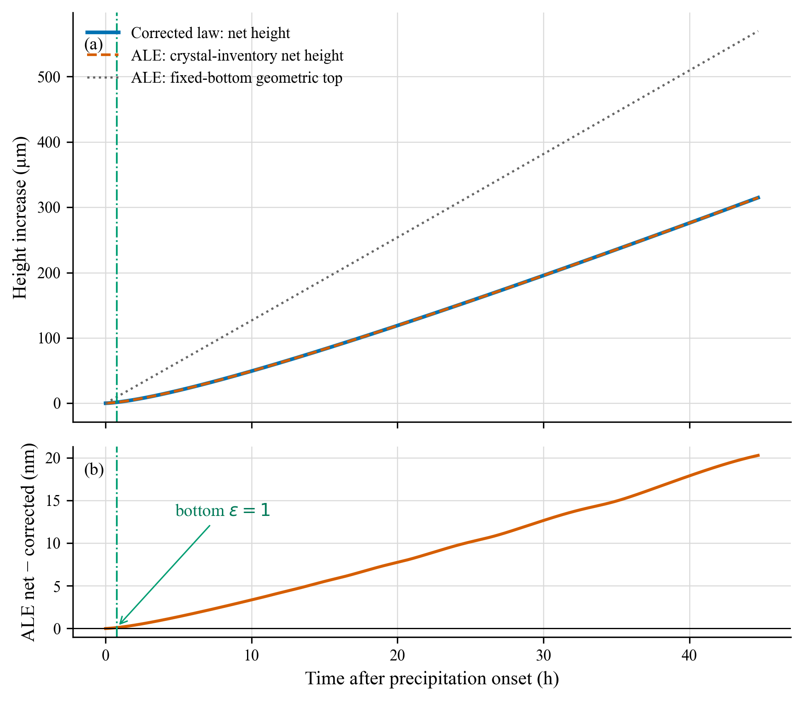
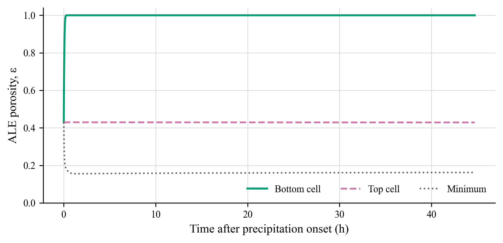

# x0=0.08 土壤反扩散驱动下：修正增长律与 ALE 对比

## 最重要的结果

按用户指定的“净生长高度”口径，修正模型与 ALE 基本重合：44.70875 h 后两者分别得到 **318.249 µm** 和 **318.269 µm**，净增量相对差为 **0.00644%**。

这个结果成立的前提是把 ALE 高度换算为

\[
h_{net}^{ALE}=h_0+\frac{M_{cr}(t)-M_{cr}(0)}{\rho_{cr}\phi_{core}}.
\]

ALE 的固定底面几何顶高同期为 **573.346 µm**，不能与上述净固体库存高度混称。若实验测量的是壳顶空间位置，还必须建立底部退缩或壳体下沉的运动学闭合。

## 本次具体做了什么

- 新建并使用分支 `research/p2-h-corrected-vs-ale-x008`。
- 从既有 `x0=0.08` 土柱读取首次析盐后 (j(t)) 和向下反扩散 (B_{soil}(t))，不平滑、不外推，只在存储时刻之间线性插值。
- 修正模型使用

  \[
  P=(C_{eq}j-B_{soil})/(1-C_{eq}),\qquad
  \dot h=P/(\rho_{cr}\phi_{core}).
  \]

- ALE 使用同一 (j(t))、(B_{soil}(t))、材料参数和 (h_0=3.5\,\mu\mathrm m)。
- 仅在显式开关下允许 (arepsilon=1)，并改用非负固相体积作为 BDF 主变量。旧 ALE 默认行为保持不变。
- 生产计算在 HPCC `cnmix` 计算节点完成，Slurm job `16569032`，64 个 ALE 单元，10 s 输出间隔，共 16097 个输出时刻。

## 主要数值

| 指标 | 数值 |
|---|---:|
| (Da^*) | 3.17503557 |
| (sqrt{Da^*}) | 1.78186295 |
| (phi_{core}) | 0.88988992 |
| 修正模型最终净高度 | 318.249142 µm |
| ALE 最终净高度 | 318.269417 µm |
| 最终绝对差 | 20.275 nm |
| 净增量相对差 | (6.4415\times10^{-5}) |
| ALE 固定底面几何顶高 | 573.346069 µm |
| 底部首次完全溶解 | 0.75278 h |
| 最大盐守恒残差 | (7.29\times10^{-13}\,\mathrm{kg\,m^{-2}}) |
| 最大水守恒残差 | (3.63\times10^{-12}\,\mathrm{kg\,m^{-2}}) |

## 对结果的严格解释

这是一项**守恒一致性验证**，不是独立的动力学验证。两种净高度都由盐库存和同一个 (phi_{core}) 换算，因此高度重合主要说明：在同一供盐定义下，修正总量模型与守恒 ALE 没有矛盾。

几何层面并未对齐。ALE 的孔隙率显著非均匀，底部已完全溶解而内部最小孔隙率降至 0.1628。把这种结构压缩为一个常数 (phi_{core}) 只定义了等效库存高度，不等于真实几何厚度。

此外，按修正式重构的累计供盐为 0.606399 kg m⁻²，而原土壤文件直接导出的累计净 SCVF 盐通量是 0.594990 kg m⁻²，差约 1.92%。本次遵照任务使用 (B_{soil}) 和修正式；后续论文不能把这两个供盐口径混在一起。

## 运行与失败记录

- `16569015`：旧 (arepsilon<0.95) 上界下在 420 s 停止，作为旧模型失败前缀保留。
- `16569020`：简单放宽至 (arepsilon=1) 后，保守变量仍可在试探步越界，于 1860 s 停止。
- `16569022`：改用非负固相体积后推进到 81890 s，但内部 Newton 试探态在 (S=0) 附近触发伪越界。
- `16569032`：仅对未接受试探态做物理区间投影后完成全部 160951.5 s，调度退出码 0，守恒门槛通过。

失败尝试没有覆盖或伪装为成功结果；远端均保留独立证据目录，本地保留关键失败前缀。

## 可复现文件

- `analyze_compare.py`：公式积分、同口径换算、表格和绘图。
- `results/x008_forcing.csv`：冻结后的 (j(t))、(B_{soil}(t)) 输入。
- `results/ale_history.csv`：最终 ALE 历史。
- `results/comparison_timeseries.csv`：两种高度的逐时刻对比。
- `results/comparison_summary.json`：汇总数值与守恒指标。
- `source/`：远端编译使用的 ALE、BDF、驱动和算子测试源文件。
- `run_hpcc.sbatch`：生产计算脚本。
- `pack_results.sbatch`：仅在计算节点打包结果的脚本。

更完整的公式与可支持结论边界见 `DERIVATION_AND_COMPARISON.md`。
